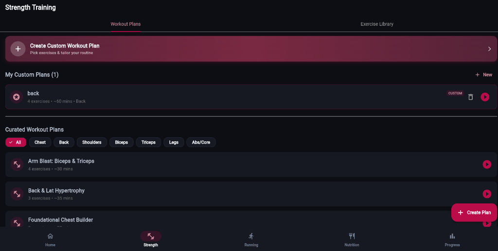
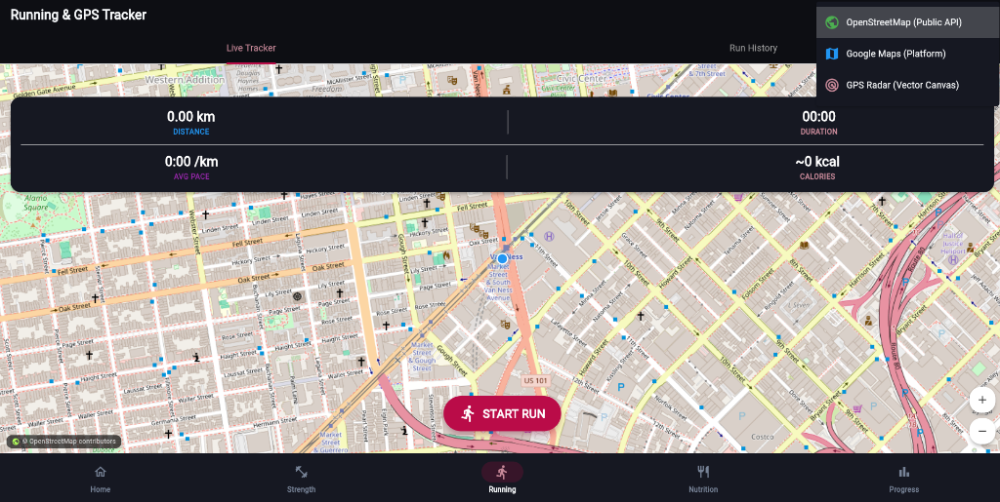
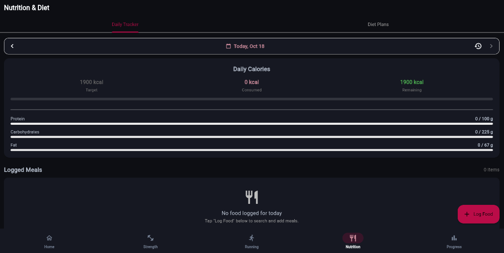
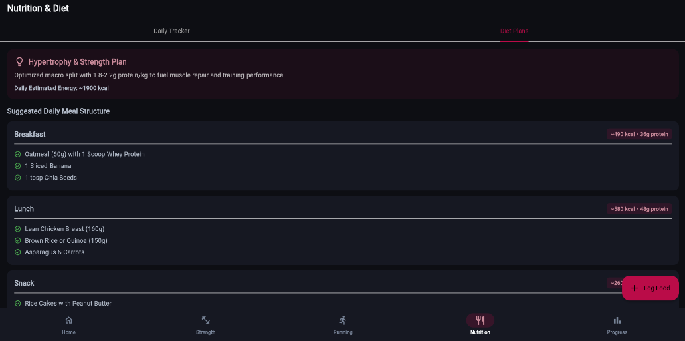

# OmniFit (FitTracker) 🏋️‍♂️⚡

[](https://flutter.dev)
[](https://dart.dev)
[](https://firebase.google.com)
[](https://ai.google.dev)
[](LICENSE)

**OmniFit** is a full-featured, cross-platform fitness companion built from the ground up with **Flutter** and **Firebase**. It bridges the gap between structured strength training, live GPS run tracking, daily macro nutrition, and personalized intelligence—powered by an on-device **Google Gemini AI Coach**.

Crafted with a signature **Crimson Berry & Sleek Obsidian** design language, OmniFit delivers a fluid, responsive experience across narrow mobile viewports (down to 320px) up to ultra-wide desktop monitors.

---

## 📱 App Preview & Module Walkthrough

### 🏋️ Strength Training & Custom Routines

* **Curated & Custom Splits:** Filter workouts by target muscle groups (Chest, Back, Shoulders, Arms, Legs, Core) or build personalized routines with customized exercises, target sets, and estimated durations.

### 🏃‍♂️ Real-Time GPS Running Tracker

* **Live Telemetry & Multi-Engine Mapping:** Live route tracking with switchable map providers (OpenStreetMap, Google Maps Platform, Vector Radar Canvas). Displays real-time distance, average pace, elapsed time, and estimated calorie burn.

### 🥗 Daily Nutrition & Macro Budget

* **Precision Calorie & Macro Tracking:** Real-time calculation of remaining calories and dedicated macronutrient progress bars for Protein, Carbohydrates, and Fats with historical date navigation.

### 🍽️ Goal-Based Diet & Meal Plans

* **Structured Meal Breakdown:** Recommended nutrition guidelines (such as Hypertrophy & Strength) with itemized meal breakdowns (Breakfast, Lunch, Snacks) showing estimated kcal and protein per serving.

---

## 🌟 Key Highlights & Features

### 1. 🏋️ Strength Training & Custom Routines
- **Pre-Built Muscle Splits:** Curated routines targeting Chest, Back, Legs, Shoulders, Arms, and Core.
- **Custom Workout Plan Builder:** Build customized routines with exercise selection, target sets/reps, estimated duration, and difficulty ratings.
- **Active Workout Session:**
  - Track **actual** sets, reps, and weights lifted (not just checkmarks).
  - Built-in rest timers with overlay alerts.
  - Automatic **Personal Record (PR)** detection with real-time celebration dialogs.
  - Auto-calculated volume metrics and estimated calories burned.

### 2. 🏃‍♂️ Live GPS Running Tracker
- **Real-Time Route Plotting:** Live interactive map powered by `geolocator` and map integration.
- **Dynamic Metrics:** Instant calculation of distance (using the Haversine formula), current pace, duration, and calorie expenditure.
- **Route Visualizer:** Post-run interactive path visualizer and workout history cards.

### 3. 🥗 Nutrition & Macro Counter
- **Daily Targets:** Macro distribution (Protein, Carbs, Fats) and calorie budget tracking with animated progress rings.
- **Clean USDA Food Search:** Real-time food lookup with formatted, human-readable ingredient parsing.
- **Categorized Meals:** Log items into Breakfast, Lunch, Dinner, and Snacks with instant recalculation.

### 4. 🤖 Omni Fitness AI Coach (Google Gemini)
- **Context-Aware Assistance:** Integrated with Google Gemini to act as a personal certified trainer and nutritionist.
- **Profile Grounding:** Ingests user metrics (age, weight, height, activity level, fitness goals) to suggest tailor-made routines and diet adjustments.
- **Interactive Chat:** Ask for form checks, recovery advice, exercise substitutes, or macro breakdowns on the fly.

### 5. 📊 Analytics & Progress Tracking
- **Interactive Visualizations:** Powered by `fl_chart` to monitor weight fluctuations, volume progression, and session frequency over time.
- **Workout Story Cards:** Sharable summary cards highlighting key accomplishments and milestones.

### 6. ⚡ Offline-First Architecture & Performance
- **Instant Cold Starts:** Authentication and profile checks use Firestore `Source.cache` priority—returning users load in **0–5 ms**.
- **Pre-Bundled Local Assets:** All athletic visuals are bundled under `assets/images/`, ensuring 0ms asset latency and zero mobile data consumption.

---

## 🏗️ Architecture & Project Structure

The project follows a clean **Layered / MVVM-inspired architecture** using Flutter's official `Provider` pattern for predictable, reactive state management.

```
lib/
├── app/                  # App initialization, routing, and centralized Crimson Berry theme
│   ├── app.dart
│   ├── routes.dart
│   └── theme.dart
├── models/               # Data models with JSON / Firestore serialization
│   ├── user_model.dart
│   ├── exercise_model.dart
│   ├── workout_model.dart
│   ├── run_model.dart
│   └── food_model.dart
├── providers/            # Business logic & reactive state management
│   ├── auth_provider.dart
│   ├── strength_provider.dart
│   ├── running_provider.dart
│   └── nutrition_provider.dart
├── screens/              # UI presentation layer
│   ├── landing/          # Responsive landing screen (Hero, FAQs, Features)
│   ├── auth/             # Login, Register, Google Sign-In
│   ├── onboarding/       # Multi-step profile setup (Goals, stats, level)
│   ├── home/             # Quick-actions, daily streaks, hero card
│   ├── strength/         # Plans, custom builder, live workout, PR summary
│   ├── running/          # GPS map, live run controls, run details
│   ├── nutrition/        # Macro tracking, USDA food search
│   ├── ai_coach/         # Gemini AI chat interface
│   ├── progress/         # Analytical charts (fl_chart)
│   └── profile/          # Settings, theme switches, account management
├── services/             # Low-level infrastructure services
│   ├── firestore_service.dart
│   ├── gemini_service.dart
│   └── location_service.dart
├── utils/                # Constants, asset helpers, unit converters
└── widgets/              # Reusable UI components & dialogs
```

---

## 🛠️ Tech Stack

| Layer | Technology |
|---|---|
| **Framework** | [Flutter](https://flutter.dev) (v3.x) |
| **Language** | [Dart](https://dart.dev) (v3.x) |
| **State Management** | [`provider`](https://pub.dev/packages/provider) |
| **Backend & Database** | [Cloud Firestore](https://firebase.google.com/docs/firestore) (with offline cache persistence) |
| **Authentication** | [Firebase Authentication](https://firebase.google.com/docs/auth) (Email/Password + Google Sign-In) |
| **Artificial Intelligence** | [Google Gemini API](https://ai.google.dev/) |
| **Location & Maps** | [`geolocator`](https://pub.dev/packages/geolocator) & [`google_maps_flutter`](https://pub.dev/packages/google_maps_flutter) |
| **Data Visualization** | [`fl_chart`](https://pub.dev/packages/fl_chart) |

---

## 🚀 Getting Started

### Prerequisites
- [Flutter SDK](https://docs.flutter.dev/get-started/install) (`^3.19.0` or higher)
- [Dart SDK](https://dart.dev/get-dart) (`^3.3.0` or higher)
- A Firebase project with **Authentication** and **Cloud Firestore** enabled.
- A Google Gemini API key (from [Google AI Studio](https://aistudio.google.com/)).

### 1. Clone the Repository
```bash
git clone https://github.com/chintanparmar011/workout-tracker.git
cd workout-tracker
```

### 2. Install Dependencies
```bash
flutter pub get
```

### 3. Configure Firebase
Install and run the FlutterFire CLI to generate your `firebase_options.dart`:
```bash
# Activate FlutterFire CLI if you haven't already
dart pub global activate flutterfire_cli

# Configure your project
flutterfire configure
```

### 4. Configure Gemini AI API Key
Supply your Gemini API key via environment variables or pass it during launch:
```bash
flutter run --dart-define=GEMINI_API_KEY=your_actual_gemini_api_key_here
```

### 5. Launch the Application
- **Mobile (Android/iOS):**
  ```bash
  flutter run
  ```
- **Web:**
  ```bash
  flutter run -d chrome
  ```

---

## 🧪 Testing & Code Quality

OmniFit includes widget and unit test suites covering responsive layouts, math calculations, model serialization, and theme palette constraints:

```bash
# Run all unit and widget tests
flutter test

# Run the comprehensive Crimson Theme & Responsive suite
flutter test test/crimson_theme_and_landing_test.dart

# Run static analysis and lint checks
dart analyze lib test
```

---

## 🎨 Design System: Crimson Berry & Obsidian

The app utilizes a custom dark-mode aesthetic engineered for high contrast and visual focus in low-light gym environments:
- **Obsidian Black (`#0D0D11`):** Deep canvas background that conserves battery on OLED displays.
- **Slate Card (`#1A1A24`):** Elevated surfaces for cards, bottom sheets, and tiles.
- **Crimson Berry (`#E50914` / `#DC143C`):** High-energy primary accents for CTAs, active states, and streak badges.
- **Pure White & Muted Slate (`#FFFFFF` / `#94A3B8`):** Readable typography with WCAG AA compliance.

---

## 📄 License

This project is licensed under the MIT License — see the [LICENSE](LICENSE) file for details.